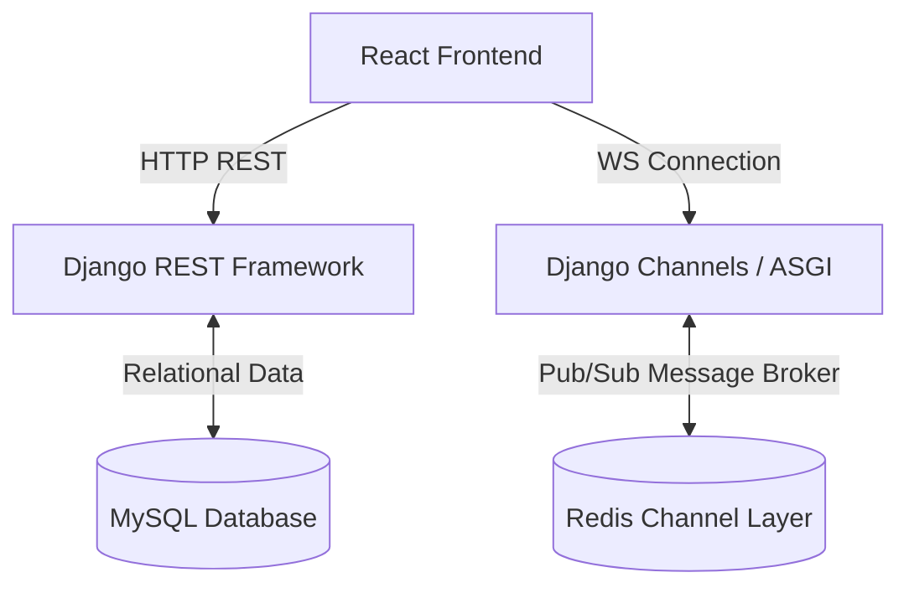

# 🧠 SoulCare — Online Stress and Depression Detection System

**SoulCare** is a comprehensive, full-stack mental health ecosystem designed to address the challenges of fragmented mental healthcare. It bridges the gap between individuals seeking support and professional care providers (doctors and counselors). The platform provides a secure, unified space where patients can self-assess their mental wellness through interactive games, keep emotional health journals, schedule video consultations, and securely message clinicians. Simultaneously, it equips healthcare professionals with practice dashboards, scheduling tools, progress notes, and digital prescriptions to deliver high-quality care efficiently.

---

## 🧭 Table of Contents

1. [Key Features](#-key-features)
2. [Role-Based Permissions](#-role-based-permissions)
3. [Modern Tech Stack](#-modern-tech-stack)
4. [Architecture & How It Works](#-architecture--how-it-works)
5. [Getting Started & Local Setup](#-getting-started--local-setup)
    * [Prerequisites](#prerequisites)
    * [1. Backend Setup](#1-backend-setup)
    * [2. Frontend Setup](#2-frontend-setup)
6. [Running the Services](#-running-the-services)
7. [Security & Optimization Measures](#-security--optimization-measures)

---

## ⚡ Key Features

*   **💬 Real-Time Provider Chat:** Secure, full-duplex WebSocket messaging between patients and clinicians powered by Django Channels and Redis. Includes connection resilience (automatic reconnects) and custom cursor-based message history pagination to scale with long conversations.
*   **📅 Scheduling & State Lifecycle:** A robust booking engine that transitions appointments through `Pending` ➔ `Scheduled` ➔ `Completed` / `Cancelled` states, with server-side conflict resolution preventing double-bookings.
*   **📈 Clinical Management Tools:** Clinician-authored progress notes, digital prescriptions (with medication frequencies and specific intake instructions), and dynamic practice statistics showing patient numbers and schedule metrics.
*   **🧠 Stress & Wellness Assessments:** Interactive assessments, including cognitive reaction-time games, word-association tests, and color therapy modules, designed to help patients track emotional trends and self-monitor.
*   **📓 Private Journaling & Mood Tracker:** Daily journaling diaries and mood logging charts to foster self-awareness and help patients track their mental health progression over time.
*   **📣 Content Library & Blogs:** Educational resources, worksheets, and blogs authored by medical professionals to promote public mental health literacy, moderated via admin workflows.
*   **🔐 Secure Login & Recovery:** Token-based stateless authentication utilizing JWT (SimpleJWT) and email recovery systems with cryptographically signed, time-sensitive tokens.
*   **🛡️ Administrative Controls:** Admin panel to verify medical credentials and documents (licensing files), moderate public landing page testimonials, and export game metrics.

---

## 🧑‍💻 Role-Based Permissions

| Role | Dashboard Features & Capabilities |
| :--- | :--- |
| **Patient** | Complete stress assessments, play cognitive games, track moods, maintain private journals, read public resources, and book appointments/chat with providers. |
| **Doctor** | Manage clinical calendars, write progress notes, issue digital prescriptions, write educational blogs, and chat in real-time. |
| **Counselor** | Monitor permitted patient mood charts, manage therapy sessions, post mindfulness content, and message patients. |
| **Admin** | Approve medical licenses (secure media files), moderate testimonials, audit draft blogs, and export game datasets (CSV streaming). |

---

## ⚙️ Tech Stack

SoulCare is built on a decoupled full-stack architecture optimized for low-latency state synchronization and secure access control.

*   **Frontend:** React.js, TypeScript, Tailwind CSS, TanStack Query (React Query), Axios
*   **Backend:** Django, Django REST Framework (DRF), Django Channels (ASGI), simple-jwt
*   **Real-Time Layer:** WebSockets, Redis (Pub/Sub Channel Broker), Daphne
*   **Database:** MySQL

---

## 🎨 System Architecture



---

## 📦 Getting Started & Local Setup

Follow these instructions to spin up the application on your local machine.

### Prerequisites
*   **Python** (v3.10 or higher)
*   **Node.js** & **npm** (v18 or higher)
*   **MySQL Server** (e.g., from XAMPP or WAMP)
*   **Redis** (or Memurai for Windows)

---

### 1. Backend Setup
1. Clone the repository and navigate to the backend folder:
   ```bash
   git clone https://github.com/BhanukaJanappriya/SoulCare.git
   cd SoulCare/soulcare_backend
   ```
2. Set up a Python virtual environment and activate it:
   ```bash
   python -m venv .venv
   # Windows:
   .venv\Scripts\activate
   # macOS/Linux:
   source .venv/bin/activate
   ```
3. Install the Python dependencies:
   ```bash
   pip install -r requirements.txt
   ```
4. Create a `.env` file in `soulcare_backend/` and configure your database endpoints:
   ```env
   DB_NAME=soulcare_db
   DB_USER=root
   DB_PASSWORD=your_mysql_password
   DB_HOST=127.0.0.1
   DB_PORT=3306
   ```
5. Ensure MySQL is running, create the `soulcare_db` database, and run migrations:
   ```bash
   python manage.py migrate
   ```

---

### 2. Frontend Setup
1. Navigate to the frontend directory:
   ```bash
   cd ../soulcare_frontend
   ```
2. Install npm dependencies:
   ```bash
   npm install
   ```
3. Create a `.env` file in the frontend root to bind environment variables:
   ```env
   VITE_API_BASE_URL="http://localhost:8000"
   VITE_WS_URL="ws://localhost:8000"
   ```

---

## 🏃 Running the Services

To run the application, start the services in separate terminal windows:

### A. Start Redis
Verify your Redis server is running on port `6379`.
```bash
# Windows (if using native Redis/Memurai service, it starts automatically)
redis-cli ping
# Output should be: PONG
```

### B. Launch Daphne ASGI (Backend Server)
```bash
cd soulcare_backend
daphne -p 8000 soulcare_backend.asgi:application
```

### C. Run Vite Development (Frontend Client)
```bash
cd soulcare_frontend
npm run dev
```

You can now access SoulCare at `http://localhost:5173`.

---

## 🛡️ Security & Optimization Measures

*   **WebSocket Auth Handshake:** WebSockets establish connections anonymously and must send a JSON authorization handshake message (`{"type": "auth", "token": "<JWT_TOKEN>"}`) within 3 seconds. Failed handshakes are immediately closed by the backend to prevent token exposure in proxy logs.
*   **Cursor-Based Pagination:** Instead of utilizing high-cost SQL `LIMIT`/`OFFSET` queries that suffer from duplicate message offsets on database insertions, the messages view implements cursor-based pagination utilizing a `before_id` cursor.
*   **Conflict Resolution Scheduler:** Server-side booking validations audit incoming dates and time slots against active sessions for target providers to strictly prevent double-bookings.
*   **Bulk Database Seeding:** The backend includes optimized bulk queries replacing costly $O(N)$ database write loops with structured sets.
